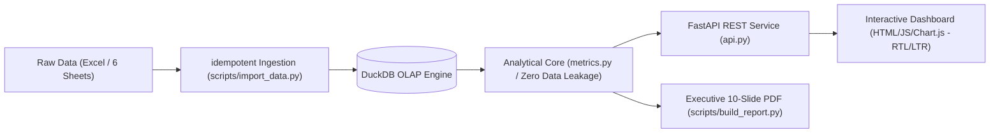

# People Analytics – HR Dashboard & Pipeline

[](https://www.python.org/)
[](https://duckdb.org/)
[](https://fastapi.tiangolo.com/)
[](tests/)
[-blueviolet.svg)](hr_analytics/static/)
[](LICENSE)

An end-to-end, evidence-first People Analytics system analyzing 12 months (2025) of organizational human resources data.
The pipeline spans idempotent data ingestion, in-memory OLAP analytics via **DuckDB**, strict data-quality audit, a clean **FastAPI** service, an interactive bilingual dashboard (Persian/English, RTL/LTR), and automated PDF executive report generation.



---

## Architecture & Project Structure

```
data/PA_Task.xlsx        Input workbook (6 sheets: Employees, Monthly, Attrition, Surveys, Reviews, Recruitment)
hr_analytics/db.py       Schema definition + idempotent upsert import + data-quality audit register
hr_analytics/metrics.py  Core calculation engine (independent from API/UI for standalone scripting)
hr_analytics/api.py      FastAPI REST backend (+ serves static bilingual dashboard)
hr_analytics/static/     Vanilla JS dashboard (Chart.js, bundled Persian Vazirmatn fonts – 100% offline)
scripts/import_data.py   CLI data ingestion pipeline
scripts/build_report.py  CLI headless Chromium PDF executive report generator
tests/                   Unit, API integration, regression, and Playwright E2E browser tests
docs/METRICS.md          Full metric formulas, joins, and data-quality decisions
docs/API.md              OpenAPI endpoint specifications
report/                  People_Analytics_Report.pdf (+ slides.html)
```

---

## Key Engineering Decisions

* **DuckDB for Analytical Queries:** Leverages window functions for lagged predictors without heavy external database dependencies. The API opens DuckDB in read-only mode to enable concurrent query handling.
* **Idempotent Ingestion Pipeline:** Composite primary keys combined with atomic transaction upsert (`INSERT OR REPLACE`). Safe to re-run anytime without duplicating or corrupting records.
* **Leakage-Free Predictive Modeling:** Predictor variables strictly use lagged prior-month observations (`t-1`). Unreliable demographic fields (e.g., implausible Date of Birth present in ~54% of records) are audited and excluded.
* **Statistically Rigorous Metrics:** 
  - Wilson 95% Confidence Intervals for attrition rates.
  - Wald 95% Confidence Intervals for odds ratios.
  - True Kaplan–Meier survival curve for new hire retention with censoring at study end.
  - Declined offers and incomplete probation periods remain `NULL` rather than misrepresented as zeroes.
* **Zero External CDN Dependencies:** All fonts (Vazirmatn Arabic/Persian) and libraries (Chart.js) are locally bundled for fully offline environments and airtight corporate intranets.

---

## Quick Start

### 1. Installation
```bash
# Clone the repository
git clone git@github.com:abbasi0abolfazl/hr-analytics.git
cd hr-analytics

# Setup virtual environment
python3 -m venv .venv
source .venv/bin/activate
pip install -r requirements.txt

# (Optional) Install Chromium for automated browser tests & PDF building
python -m playwright install chromium
```

### 2. Ingest Data
```bash
# Ingest Excel sheets into DuckDB (safe to re-run)
python scripts/import_data.py
```
> Custom file paths can be specified via:
> `python scripts/import_data.py --xlsx path/to/file.xlsx --db path/to/hr.duckdb`

### 3. Run the API & Dashboard
```bash
uvicorn hr_analytics.api:app --port 8000
```
* **Interactive Dashboard:** [http://localhost:8000](http://localhost:8000)
* **Interactive OpenAPI Docs:** [http://localhost:8000/docs](http://localhost:8000/docs)

---

## Automated Test Suite

The test suite covers unit logic, real-data regression, API contracts, and browser interactions:

```bash
pytest -v
```

```
tests/test_api.py .......................                                [ 50%]
tests/test_dashboard_e2e.py s                                            [ 52%]
tests/test_import.py .......                                             [ 67%]
tests/test_metrics.py ...............                                    [100%]

======================== 45 passed, 1 skipped in 11.2s ========================
```

* `test_import.py` – Idempotency, duplicate rejection, rollback under schema errors, row validation.
* `test_metrics.py` – Verified calculations on synthetic fixtures (headcount conservation law, turnover rates, survival curves, Wilson CI).
* `test_api.py` – Response envelope validation, 422 payload contracts, filter query parameters, 404/503 handlers.
* `test_dashboard_e2e.py` – Playwright browser interaction test verifying API fetch upon filter toggles.

---

## Generate Executive PDF Report

```bash
python scripts/build_report.py
```
Outputs a production-ready, 10-slide executive presentation to `report/People_Analytics_Report.pdf` with synchronized analytical figures.

---

## License

This project is licensed under the [MIT License](LICENSE).
